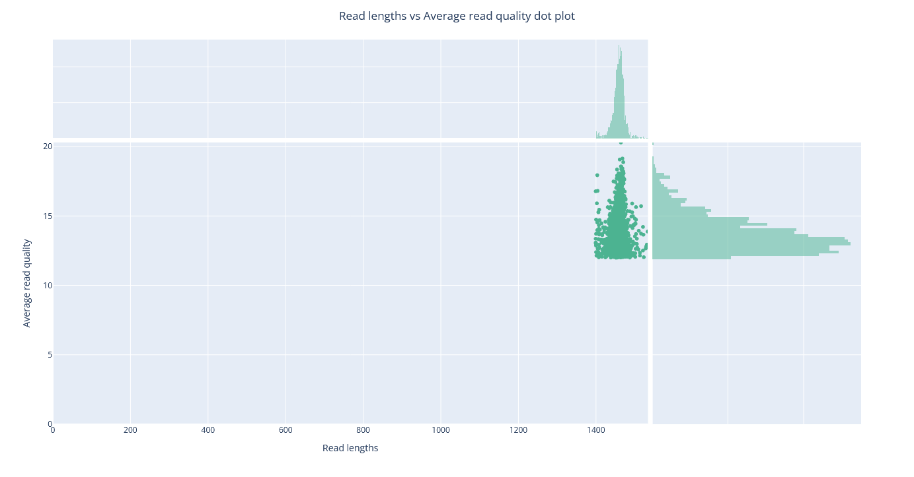
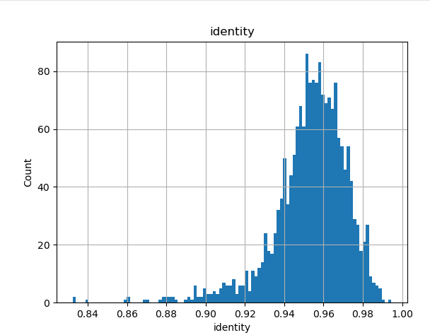
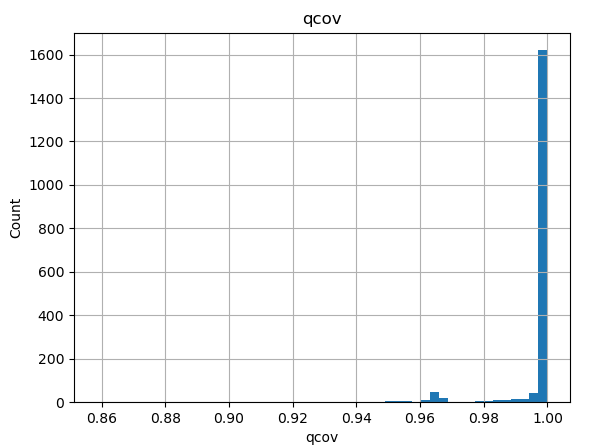
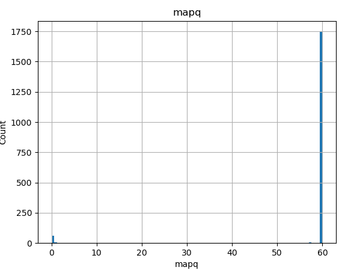

---
execute:
  eval: false
engine: knitr
---

# Amplicon long-read analysis

Now that we have learned how to use the command line to issue commands and use an HPC we can now analyse our long-read amplicon data and:

- Perform quality filtering by choosing appropriate cutoffs based on our quality assessment we did in the prior section
- Align the quality filtered reads to a reference database 
- Generate a count matrix 

**Important**: All of this should be run on the Crunchomics HPC, so be sure that you connected with `ssh -X user@omics-h0.science.uva.nl`.

## `chopper`: Quality cleaning 

In this section, you will learn how to perform quality filtering of your amplicon long-read data using **chopper**. Quality control is an essential first step to remove low quality reads that introduce errors in downstream analyses such as sequence alignment. Typical things you want to do are:

- Remove sequence adapters, barcodes, primer sequences (this already has been done for your data)
- Remove reads with a too low quality score
- Remove reads that are too long or too short
- Trim read ends if they have low quality scores

`chopper` is designed for filtering and trimming of long-read data and you can install `chopper` with mamba:

```{bash}
mamba create -n chopper_0.15.0 -c bioconda chopper=0.15.0
```

In this tutorial, you will always receive example code as a starting point, with sections containing `...` for you to fill in. If you get stuck in this section, first check [chopper's documentation](https://github.com/wdecoster/chopper) or use the built-in help via the CLI (`chopper -h`).

::: {.callout-question .callout-warning collapse=false}
# Tasks 

Use your NanoPlot quality plots from the previous section and choose some quality and length cutoffs.

**Task 1: Perform quality filtering using chopper**

Do the following:

- Create a new folder to store the results and name the output file `barcodeX_filtered.fastq.gz`
- Request 1 task, 2 CPUs and 20G of memory with `srun`, and ensure chopper itself also uses 2 threads
- Investigate the Nanoplot LengthvsQualityScatterPlot_dot.html that you generated in the last exercise and decide on the right thresholds to use with chopper to:
  - Discard sequences that are too long or too short
  - Discard reads with a too low phred score
  - Trim low-quality bases from the read ends
- Check the [tools manual](https://github.com/wdecoster/chopper) carefully for how to deal with `.gz` files. Hint: Closely check the example section

> **IMPORTANT**: After chopper finished you will see something like "Kept 1772 reads out of 3785 reads". If you see less than 50% of the reads remaining use less strict length and quality filters. You need enough reads for the next steps


**Task 2: Assess the quality of the filtering step**

Investigate the quality of the filtered FASTQ file by running:

-  NanoPlot
-  seqkit
   -  **Important**: Be sure that you name the output file something like `barcodeX_filtered.tsv`, we need this file later!

Afterwards open NanoPlots and seqkit. Investigate the outputs and record:

 - The total number of sequences that went into the analysis
 - The total number of sequences that passed the quality filtering


```{bash}
# Generate an output folder for the results
... 

# Activate the chopper conda environment
...

# Run chopper
srun --ntasks=1 --cpus-per-task=2 --mem=20G chopper ...

# Deactivate the conda environment 
...

# Make a folder for the Nanoplot results and run Nanoplot 
# (don't forget to activate the right conda environment first and deactivate it after)
srun ...

# Run seqkit
# Make sure that the output file is something like path/barcodeX_filtered.tsv
srun ...
```


::: {.callout-answer .callout-warning collapse=true}
# Click to see the answer 

```{bash}
# Generate an output folder for the results
mkdir results/chopper

# Activate the chopper conda environment
conda activate chopper_0.15.0

# Run chopper
srun --ntasks=1 --cpus-per-task=2 --mem=20G chopper \
    -i data/barcodeX.fastq.gz \
    -q 12 \
    --trim-approach trim-by-quality --cutoff 12 \
    --minlength 1400 --maxlength 1540 \
    --threads 2 | gzip \
    > results/chopper/barcodeX_filtered.fastq.gz

# Deactivate the conda environment
conda deactivate

# Run Nanoplot
conda activate nanoplot_1.48.0

mkdir -p results/nanoplot/cleaned

srun --ntasks=1 --cpus-per-task=2 --mem=10G NanoPlot \
    --fastq results/chopper/barcodeX_filtered.fastq.gz \
    -t 2 \
    --tsv_stats \
    --plots dot \
    -o results/nanoplot/cleaned

conda deactivate

# Run seqkit 
srun --ntasks=1 --cpus-per-task=1 --mem=5G seqkit stats results/chopper/barcodeX_filtered.fastq.gz  \
    -Tao results/seqkit/barcodeX_filtered.tsv --threads 1

```

Below are the results for the example file `barcode07.fastq.gz`. Your own barcode will give different numbers. Your sample most likely has more reads than this example, and the share of reads that pass depends on how the sequencing went.

- Input: 3,785 reads
- Passed filtering: 1,772 reads (47%). This is just under the 50% we recommend above. For this file, you could loosen the length or quality cutoffs a little. You ideally want to keep 50%-90% of the reads for the downstream analyses, depending on the quality of the data and how many reads you generated.

This is the NanoPlot read length against read quality plot for `barcode07` after chopper. Compare it with the plot before filtering in the HPC chapter. The short reads, the very long reads and the reads with a quality below 12 are gone. All reads are now between 1,400 and 1,540 bp:

{width=90%}

:::
:::


## `Minimap2`: Map reads to reference database

Nanopore long-read sequencing can produce reads that span nearly the entire 16S rRNA gene, making it useful for identifying microbial species. However, these long reads come with a trade-off: they have a higher error rate compared to short-read technologies.

Assume that your average read quality is **Q10**. The Phred score (Q) is a measure of how confident the sequencer is in each base call. The probability of a base being called incorrectly can be calculated as:

$$P=10^{-Q/10}$$

In R we can compute this with:

```{r}
#| eval: true
Q <- 12
P_error <- 10^(-Q/10)
percent_error <- P_error * 100
message("Error rate: ", round(percent_error, 2), "%")
```

This shows that with a mean Phred quality of 12, each base has roughly a 6% chance of being incorrect. For a 1,500 bp 16S amplicon we expect 90 errors per sequence with such a quality score. While Nanopore long reads are useful because they capture the full 16S rRNA gene, a high level of errors can make species-level identification unreliable.

To classify our filtered Nanopore reads, we use **Minimap2** to map each read against a reference database of 16S rRNA sequences from all the strains used in your lab experiments. Mapping identifies the reference sequence most similar to each read. The read is then aligned base-by-base to the corresponding reference sequence to check for exact matches or mismatches. Depending on the similarity, one or more hits may be recorded for each read.

Mapping tools like Minimap2 are well-suited for Nanopore data because they tolerate mismatches as well as small insertions and deletions, which are common in error-prone long reads. The output of Minimap2 is a **PAF** (Pairwise mApping Format) file, which contains information about how well each read maps to the reference sequences.

Some reads may map equally well to multiple reference sequences (**multi-mappers**), particularly if the strains have highly similar 16S sequences (for example the different Pseudomonas strains you worked with in the lab). These multi-mapping reads are important to keep in mind when summarizing taxonomic abundances.

Crunchomics already has minimap2 installed. However, it is an older version (`minimap2 --version` prints `2.22-r1105-dirty`). The word "dirty" means that it was built from a changed copy of the code, so nobody else can install exactly this version. So, like for chopper, we install a recent version with mamba:

```{bash}
mamba create -n minimap2_2.31 -c bioconda minimap2=2.31
```

::: {.callout-question .callout-warning collapse=false}
# Tasks 

**Task 1: Get the reference database**

We have already prepared a non-redundant database of 16S rRNA gene sequences. Download it to your `data/` folder using: 

```{bash}
wget https://raw.githubusercontent.com/ndombrowski/MicEco_teaching_material/refs/heads/main/data/amplicons_nr.fasta -P data
```

This file (`amplicons_nr.fasta`) contains one to two representative 16S rRNA sequences per strain used in the lab. View the file with `head` and use `grep` to count how many sequences are in the file.

**Task 2: Run minimap2**

Next, you will map your filtered reads against the reference database using minimap2.

Before running, make sure to check all the available options with `minimap2 -h` and then make sure that you:

- Create a folder to store your results
- Activate the `minimap2_2.31` environment before you run minimap2, and deactivate it afterwards
- Use srun with 1 task, 2 CPUs and 20G of memory
- Use `-cx map-ont` for accurate Nanopore vs reference mapping
- Ensure that the output is in PAF format
- Provide both 
  -  `data/amplicons_nr.fasta` (the reference) 
  -  `barcodeX_filtered.fastq.gz` (the cleaned fastq sequences)
- Use `> results/minimap2/barcodeX.paf` to store the output

**Task 3: Explore the output**

After the alignment finishes:

- Count the number of alignments with `wc` 
- View the file with `less` and scroll through the first few lines to inspect the structure.
- Check the [minimap2 manual ](https://lh3.github.io/minimap2/minimap2.html) to find out what the different columns mean. 

Answer the following questions:

1. How many alignments are there? Is this number higher or lower than your total number of input reads? Why might that be?
2. Look at the first 12 columns of the PAF file. Which of these could help you filter unreliable alignments or identify multi-mapping reads?

```{bash}
# Count the number of reference sequences
...

# Generate a suitable output folder
...

# Activate the minimap2 conda environment
...

# Run minimap2
...

# Deactivate the conda environment
...

# Count the number of alignments
...
```

::: {.callout-answer .callout-warning collapse=true}
# Click to see the answer 

```{bash}
# Count the number of reference sequences
grep -c ">"  data/amplicons_nr.fasta

# Generate a suitable output folder 
mkdir results/minimap2

# Activate the minimap2 conda environment
conda activate minimap2_2.31

# Run minimap2
srun --ntasks=1 --cpus-per-task=2 --mem=20G minimap2 \
        -cx map-ont -t 2 \
        data/amplicons_nr.fasta \
        results/chopper/barcodeX_filtered.fastq.gz \
        > results/minimap2/barcodeX.paf

# Deactivate the conda environment
conda deactivate

# Count the number of alignments (example barcode07: 1835)
wc -l results/minimap2/barcodeX.paf

# Explore the file itself
less -S results/minimap2/barcodeX.paf
```

Answer:

1. For the example file `barcode07`, there are 1,835 alignments for 1,772 reads. Your numbers will be different. If you see more alignments than there are reads, there might be different reasons for that:
   1. If your experiment included Pseudomonas strains you likely will have more alignments than reads. The higher number of alignments occurs because some reads might align equally well to multiple reference 16S sequences, these are multi-mapping reads.
   2. Some reads might only partially or weakly align to highly similar regions in the 16S rRNA gene
2. Useful PAF columns for assessing alignment reliability include:
   - Column 10: number of matching bases (can be use to calculate % identity)
   - Column 11: total length of the alignment (including gaps; can be use to calculate % identity)
   - Column 12: mapping quality. 0 is used to mark and thereby identify multi-mappers
   - Columns 3–4: read start and end positions (can be used to calculate how much of the read aligned)

Information on the PAF output:

| Col | Description                                             |
| --- | ------------------------------------------------------- |
| 1   | Query sequence name                                     |
| 2   | Query sequence length                                   |
| 3   | Query start coordinate (0-based)                        |
| 4   | Query end coordinate (0-based)                          |
| 5   | ‘+’ if query/target on the same strand; ‘-’ if opposite |
| 6   | Target sequence name                                    |
| 7   | Target sequence length                                  |
| 8   | Target start coordinate on the original strand          |
| 9   | Target end coordinate on the original strand            |
| 10  | Number of matching bases in the mapping                 |
| 11  | Number bases, including gaps, in the mapping            |
| 12  | Mapping quality (0-255 with 255 for missing)            |

:::
:::


## Generate a count table

Now that we have our alignment results, our goal is to summarize them into a count table, a matrix showing how many reads aligned to each reference 16S rRNA sequence. Before creating the count table, we first need to filter our results to make sure we only count high-confidence matches by:

- Removing low-confidence hits by filtering out alignments with:
  - Low sequence identity (many mismatches)
  - Low coverage (only part of the read mapped to the reference)
  - Low mapping quality (reads could map equally well elsewhere)
- Selecting the single best alignment for each read (to handle multi-mappers)
  
Afterwards, we can count how many reads map to each reference sequence. These counts can then be summarized at higher taxonomic levels (e.g., genus) to account for the uncertainty due to sequencing errors.

Instead of using a single pre-built program, we will use a custom Python script to perform this step. So why use a tool like Python or R for this?

Tools like Minimap2 produce large, text-based alignment files. While command-line tools are great for specific tasks (like counting lines or filtering by quality), programming languages like Python and R allow you to:

- Combine multiple filtering criteria (e.g. identity, coverage, quality)
- Parse complex data formats
- Summarize and visualize results reproducible


::: {.callout-question .callout-warning collapse=false}
# Tasks 

**Task 1: Install the necessary software**

To run the required software, we first need to install some packages to parse the data. You can do this by running the following:

```{bash}
mamba create -n python_3.10.18 -c conda-forge python=3.10.18 matplotlib pandas

```

**Task 2: Get the python scripts**

Download the two required files:

```{bash}
wget https://raw.githubusercontent.com/ndombrowski/MicEco_teaching_material/refs/heads/main/scripts/paf_to_matrix.py -P scripts
wget https://raw.githubusercontent.com/ndombrowski/MicEco_teaching_material/refs/heads/main/data/accession_to_genus.tsv -P data
```

- `paf_to_matrix.py` is the python script that filters alignment results and generates count tables
- `accession_to_genus.tsv` is a two-column tab-delimited file linking each 16S rRNA gene accession to its genus

You can inspect the script’s help menu to understand its required inputs by typing `python scripts/paf_to_matrix.py -h`. The main arguments are:

1. `-i`: path to the folder containing PAF alignment files
2. `-o`: output folder
3. `-t`: path to two-column TSV file linking accessions to genus names
4. `-s`: (optional) seqkit stats file generated with _Tao, used to calculate unmapped reads
5. Filtering thresholds for identity, coverage, and mapping quality


**Task 3: Generate the count table**

Now, use `paf_to_matrix.py` to convert your alignment results into a count table. You will need to:

- Make sure to activate the conda environment we setup in Task 1
- Provide the path to your PAF alignment folder (`-i`)
- Add your seqkit stats file (`-s`)
- Include the accession-to-genus mapping file (`-t`)
- Choose the folder in which you want to save your results (`-o`)

> Hint: Python scripts like this one are not computationally demanding, you can safely run it on the login node without using srun.

```{bash}
# Activate the python conda environment 
... 

# Make folder to store the results 
...

# Run the python script
python scripts/paf_to_matrix.py \
  -i ... \
  -s ... \
  -t ... \
  -o ...
```

**Task 4: Explore the count table**

`paf_to_matrix.py` will:

- Print a brief summary of the filtering to the screen
- Generate several tables:
  - `otu_table_multimappers.tsv`: A count table based on all alignments, including multi-mappers
  - `otu_table.tsv`: A count table based on only best (primary) hits per read
  - `otu_table_genus.tsv`: A count table summarized at the genus rank
- Make three histograms: `identity_hist.png`, `qcov_hist.png` and `mapq_hist.png`. They show the identity, the query coverage and the mapping quality of all alignments, before the filtering

Inspect the outputs and answer the following:

1. How many reads were lost due to the filtering? Check the options of `python scripts/paf_to_matrix.py -h` and think about whether there are any parameters you would change in case too many reads were removed?
2. Are the taxa listed in your count tables consistent with the strains used in your experiment?
3. Do the relative abundances of taxa match your expectations? If not, what biological or technical factors could explain the differences?
4. Open the three histograms. To view them, copy them to your own computer, as you did for the NanoPlot output. The script removes alignments with an identity below 0.9, a query coverage below 0.9, or a mapping quality between 1 and 29. Where do these cutoffs fall in your histograms? Which filter do you think removed most of your alignments? Write your answer in your notebook.

::: {.callout-answer .callout-warning collapse=true}
# Click to see the answer 

```{bash}
# Activate the python conda environment 
conda activate python_3.10.18

# Make folder to store the results 
mkdir results/tables

# Run the python script
python scripts/paf_to_matrix.py \
  -i results/minimap2/ \
  -s results/seqkit/barcodeX_filtered.tsv \
  -t data/accession_to_genus.tsv \
  -o results/tables

conda deactivate
```

1. For the example file `barcode07`, the filtering removed 40 of 1,835 alignments (2%). Note that the summary counts alignments, not reads. If you had more alignments than reads, some of the removed alignments were likely secondary (less confident) alignments. You will also lose potential contaminations during this step. That is because reads coming from contaminant bacteria might still map to sequences in the reference database but with much lower sequence identity, and therefore will be discarded.
2. Most reads map to Streptococcus and Lactococcus, consistent with the experiment. A few unassigned reads may come from contamination or poor-quality reads (10 reads in `barcode07`).
3. Streptococcus had ~8× more reads than Lactococcus (1,576 and 186 reads in `barcode07`). This may indicate stronger growth due to better adaptation to liquid media or competitive advantage in the co-culture.
4. These are the histograms for `barcode07`:

   {width=60%}

   {width=60%}

   {width=60%}

   Almost all alignments cover the whole read (query coverage close to 1), and almost all have a mapping quality of 60. A small group has a mapping quality of 0. These are multi-mappers, and the script keeps them. The identity is mostly between 0.92 and 0.99, with a small tail below 0.9. So the identity filter removed most of the alignments: 35 of the 40. An identity of about 0.95 fits the read quality: with a mean quality of about 13.6, roughly 4% of the bases are wrong.

:::
:::


## Bonus: run the workflow on all your barcodes (optional)

So far you analysed one barcode, your largest file. In the practical you prepared more samples than that, for example your community at day 0 and at day 2. In this bonus section you run chopper and minimap2 on all your barcodes with a `for` loop. Then you make one count table with one column per barcode.

You don't need this section for the rest of the course. After the workshop you get the full count table for all samples, and the code that made it. Do this section if you have time left, or if you want to see how that table was made.

How long does it take? On the practical data, chopper takes about 6 seconds per barcode and minimap2 20 to 40 seconds. For 4 to 6 barcodes, the whole section runs in a few minutes. So `srun` is enough and you don't need a job script.

### Which steps run once per barcode?

In [Working with multiple files](cli.qmd#working-with-multiple-files) you used a `for` loop to download one file per accession. The same pattern runs a command once per barcode. But not every step should go inside the loop. Before you write the loop, look at what each step reads and what it makes.

::: {.callout-question .callout-warning collapse=false}
# Question

Which steps should run once per barcode, inside the loop? Which should run only once, after the loop?

- chopper
- minimap2
- seqkit stats
- `paf_to_matrix.py`

Hint: run `python scripts/paf_to_matrix.py -h` and read what `-i` and `-s` expect. Keep in mind what you want at the end: one count table, with one column per barcode.

::: {.callout-answer .callout-warning collapse=true}
# Click to see the answer

- **chopper and minimap2: once per barcode.** Each reads one fastq file and makes one output file for that barcode.
- **seqkit stats: once, after the loop.** seqkit can read many files at once. It writes one table with one row per file.
- **`paf_to_matrix.py`: once, after the loop.** `-i` is a folder. The script reads every `.paf` file in it and makes one column per file. `-s` is ONE seqkit file with a row for every barcode. If you put the script inside the loop, it rebuilds the table on every round, each time with the seqkit numbers of only one barcode.
:::
:::

::: {.callout-question .callout-warning collapse=false}
# Tasks

**Task 1: List your barcodes**

- Look at all files from the practical with `ls -lh /zfs/omics/projects/education/miceco/data/practical/*.fastq.gz`. Find the barcodes that your group prepared.
- Use `nano` to make a file `barcodes.txt` in your `data_analysis` folder, with one barcode per line. Write the names exactly as in the file names, without `.fastq.gz`.
- Write the list in your notebook. For each barcode, also write which sample it is (community, day).

**Task 2: Copy the fastq files with a loop**

Write a `for` loop that reads `barcodes.txt` and copies each fastq file into your `data` folder. Then check with `ls -lh data/*.fastq.gz` that every barcode is there.

**Task 3: Run chopper and minimap2 on every barcode**

- Use the same chopper cutoffs that you chose for your first barcode. Then all samples are filtered the same way, and you can compare them. Write the cutoffs in your notebook.
- Before you run the loop, put `echo` in front of `srun`. The loop then only prints the commands. Do you see one chopper command per barcode in the first loop, and one minimap2 command per barcode in the second, with the right file names? Then remove the `echo` and run the loop.
- While the loop runs, read what chopper prints for each barcode ("Kept ... reads out of ..."). Write the numbers in your notebook.

```{bash}
conda activate chopper_0.15.0

for barcode in $(cat barcodes.txt); do
    echo "Now running chopper: ${barcode}"

    srun --ntasks=1 --cpus-per-task=2 --mem=20G chopper \
        -i ... \
        ... \
        > results/chopper/${barcode}_filtered.fastq.gz
done

conda deactivate

conda activate minimap2_2.31

for barcode in $(cat barcodes.txt); do
    echo "Now running minimap2: ${barcode}"

    srun --ntasks=1 --cpus-per-task=2 --mem=20G minimap2 \
        ... \
        > results/minimap2/${barcode}.paf
done

conda deactivate
```

**Task 4: Check the output of the loop**

- Count: is there one output file per barcode? Compare the number of lines in `barcodes.txt` with the number of files in `results/chopper/` and in `results/minimap2/`.
- File sizes: look at the files with `ls -lh`. A compressed fastq file of about 20 bytes has no reads in it.
- Count the alignments in each PAF file with `wc -l`.

**Task 5: Make one count table for all barcodes**

- Run `seqkit stats` once on all filtered fastq files, and save the result as `results/seqkit/all_filtered.tsv`. Hint: use a wildcard (`*`).
- Run `paf_to_matrix.py` once. Use `results/minimap2/` for `-i` and your new seqkit file for `-s`. Save the output in a new folder `results/tables_all`, so your first table stays as it is.

Note: the script uses every `.paf` file in `results/minimap2/`. If an old file is in that folder, for example from the example data `barcode07`, it also gets a column in your table.

**Task 6: Check the count table**

Open `results/tables_all/otu_table_genus.tsv` and answer:

1. Is there one column per barcode, and no other columns?
2. Look at the column of your first barcode. Are the numbers the same as in your first count table?
3. Is the number of `unassigned` reads in a plausible range for each barcode?
4. Did the script print a line that starts with `Warning`?

Write the answers in your notebook.

::: {.callout-answer .callout-warning collapse=true}
# Click to see the answer

```{bash}
# Task 1: list the barcodes
ls -lh /zfs/omics/projects/education/miceco/data/practical/*.fastq.gz
nano barcodes.txt
cat barcodes.txt
wc -l barcodes.txt

# Task 2: copy the fastq files
for barcode in $(cat barcodes.txt); do
    cp /zfs/omics/projects/education/miceco/data/practical/${barcode}.fastq.gz data
done

ls -lh data/*.fastq.gz

# Task 3: chopper and minimap2, once per barcode
# (use your own chopper cutoffs)
conda activate chopper_0.15.0

for barcode in $(cat barcodes.txt); do
    echo "Now running chopper: ${barcode}"

    srun --ntasks=1 --cpus-per-task=2 --mem=20G chopper \
        -i data/${barcode}.fastq.gz \
        -q 12 \
        --trim-approach trim-by-quality --cutoff 12 \
        --minlength 1400 --maxlength 1540 \
        --threads 2 | gzip \
        > results/chopper/${barcode}_filtered.fastq.gz
done

conda deactivate

conda activate minimap2_2.31

for barcode in $(cat barcodes.txt); do
    echo "Now running minimap2: ${barcode}"

    srun --ntasks=1 --cpus-per-task=2 --mem=20G minimap2 \
        -cx map-ont -t 2 \
        data/amplicons_nr.fasta \
        results/chopper/${barcode}_filtered.fastq.gz \
        > results/minimap2/${barcode}.paf
done

conda deactivate

# Task 4: check the output
wc -l barcodes.txt
ls results/chopper/*_filtered.fastq.gz | wc -l
ls results/minimap2/*.paf | wc -l
ls -lh results/chopper/ results/minimap2/
wc -l results/minimap2/*.paf

# Task 5: one seqkit file for all barcodes, then one count table
srun --ntasks=1 --cpus-per-task=1 --mem=5G seqkit stats results/chopper/*_filtered.fastq.gz \
    -Tao results/seqkit/all_filtered.tsv --threads 1

less -S results/seqkit/all_filtered.tsv

conda activate python_3.10.18

mkdir results/tables_all

python scripts/paf_to_matrix.py \
  -i results/minimap2/ \
  -s results/seqkit/all_filtered.tsv \
  -t data/accession_to_genus.tsv \
  -o results/tables_all

conda deactivate

# Task 6: look at the table
less -S results/tables_all/otu_table_genus.tsv
```

1. If you see more columns than barcodes, an old `.paf` file is still in `results/minimap2/`. If you see fewer, a barcode failed in the loop. Scroll back through what the loop printed.
2. Yes. The loop runs the same commands on the same file, so your first barcode gets the same numbers again.
3. This depends on your samples. Compare the barcodes with each other. If one barcode has many more unassigned reads than the others, look at its chopper and seqkit numbers.
4. You should see no warning. `Warning: no seqkit stats found for: ...` means that a barcode in `results/minimap2/` has no row in your seqkit file. Its unassigned reads are then not counted.
:::
:::

::: {.callout-tip title="Using an LLM for this loop"}
You can ask an LLM to turn your commands for one barcode into a loop. If you do, paste the output of `python scripts/paf_to_matrix.py -h` into your question. When we prepared this course, every answer we got without the `-h` text did this step wrong. Some put the script inside the loop. One gave `-s` several files, which makes the script stop with an error. With the `-h` text, the answer was correct.

LLMs also often add lines that you didn't ask for, such as checks that skip a barcode. Read [Lines that LLMs add to loops and job scripts](llm_usage.qmd#lines-that-llms-add-to-loops-and-job-scripts) before you run such a script. This works with any chat tool, including free ones: you only paste text.
:::

