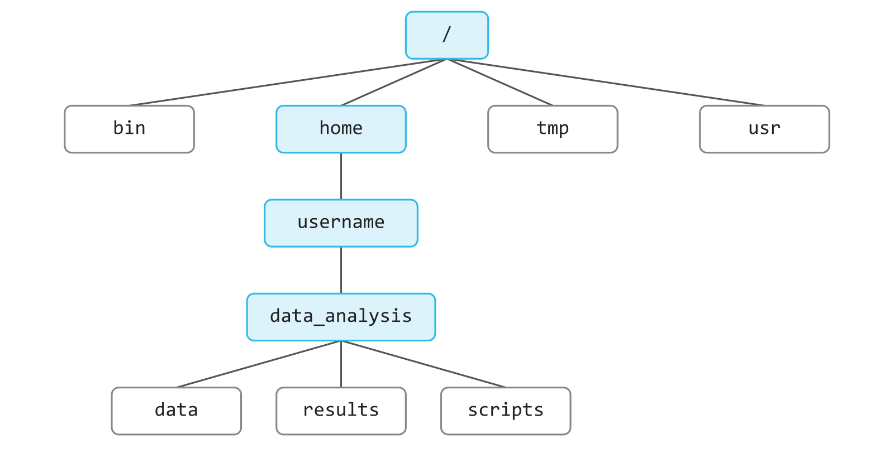

# Navigating the command line

## `pwd`: Find out where you are

To get started, open your terminal, and get yourself oriented by typing your first command and then pressing enter: 

```{bash}
pwd
```

The command `pwd` stands for *print working directory*. It tells you where you currently are in the file system, that is, which folder (directory) your shell is operating on right now. You should see something like this:

```
/home/username
```

::: {.callout-tip title="Tip: Finding the Desktop on Different Systems" collapse="true"}
Your home directory (i.e. the directory you start in whenever you open the terminal) varies slightly across operating systems. Here’s how to locate yourself and connect to familiar locations like the Desktop:

**macOS**

-   Your home directory is `/Users/username`
-   To open the folder you are currently in Finder: `open .`
-   Your desktop is at `/Users/username/Desktop`

**MobaXterm (Windows)**

-   Your home directory is `/home/mobaxterm`
-   When using the portable version of Mobaxterm this directory is temporary and is deleted when you close MobaXterm. To make it permanent:
    -   Go to Settings --\> Configuration --\> General
    -   Under Persistent home directory, choose a folder of your choice
-   To open the folder you are currently in the Windows File explorer: `explorer.exe .`
-   Your Desktop is usually at: `/mnt/c/Users/username/Desktop` or `/mnt/c/Users/username/OneDrive/Desktop` (when using OneDrive)

**WSL2 (Windows)**

-   Your home directory is `/home/username`
-   To open the folder you are currently in the Windows File explorer: `explorer.exe .`
-   Your Desktop is usually at: `/mnt/c/Users/username/Desktop` or `/mnt/c/Users/username/OneDrive/Desktop` (when using OneDrive)

If you want to access the UvA OneDrive folder and/or if your OneDrive folder name includes spaces (like OneDrive - UvA), use quotes around the path: 

```{bash}
cd "/mnt/c/Users/username/OneDrive - UvA"
```

:::


## `ls`: List the contents of a directory

Now that you know where you are, let's find out what is inside that location, i.e. what files and folders can be found there. The command `ls` (short for *list*) shows the files and folders in your current directory. Type the following and press enter:

```{bash}
ls
```

You should see something like this (your output will vary depending on what’s in your directory):

{width=90%}

The colors and formatting depend on your terminal settings, but typically:

- Folders (directories) appear in one color (often green or blue)
- Files appear in another (often white or bold)

If your directory contains many items, the output can quickly become overwhelming. To make sense of it, you can use options and arguments to control how commands behave.


## The structure of a command

A command generally has three parts:

- A **command name**: the program you want to run, i.e. `ls`
- An **option** (or **flag**): a way to modify how the command behaves, e.g. `-l` shows the list in long format, with more details. Options usually start with a `-`
- An **argument**: the input the command works on, e.g. a file or folder. Some commands work without an argument

{width=70%}

Try the following command in your current directory to "List (`ls`) the contents of the current folder and show details in long format (`-l`)":

```{bash}
ls -l
```

After running this, you see your files and folders again but as a more detailed list. In the example below you can now see additional information about who is allowed to read and change the files (the access modes that determine exactly who can do what to a file or folder), who owns them, how large the files are, when they were last modified and of course their name:

{width="80%"}


::: {.callout-tip title="Tip: Using ls in practice" collapse="false"}

Throughout this tutorial, you’ll notice that you will use `ls` frequently. There is a reason for that:

When working with data, sanity checks are essential, because it is easy to make mistakes, overwrite files, or lose track of where things are. Using simple commands like `ls`, `pwd`, `wc`, or `grep` helps you verify what is happening to your files at every step of an analysis workflow.

These habits are not just for beginners. Bioinformaticians rely on them constantly. 

:::

## Getting help

At some point, you’ll want to know what options a command has or how it works. In this case, you should first check if **manual pages** (or *man pages*) are available for the command by typing `man` followed by the command name:

```{bash}
man pwd
```

This opens the manual entry for the command pwd. You can scroll through it using:

- ↑ / ↓ arrows or the space bar to move down
- b to move back up
- q to quit the manual

**MobaXterm users:** MobaXterm does not come with manual pages, so `man pwd` does not work. Use `pwd --help` instead (see below). If one way gives an error, try the next.

Not all commands come with such a manual. Depending on the program, there are a few common patterns you can try to get help:

-   `man pwd`
-   `pwd --help`
-   `pwd -h`


## `mkdir`: Make a new folder

Before you start moving around, let's first learn how to create new folders (also called **directories**). This is something you will do often, for example, to keep raw data, results, and scripts organized in separate places. The command you use for that is `mkdir`, which stands for *make directory*.

For now, you will use `mkdir` to create a project folder with the name `data_analysis` for this tutorial. Don’t worry about how to move into the folder yet. You will learn that in the next section.

```{bash}
# Move into the home directory (the starting point of your system)
cd ~

# Create a new folder called 'data_analysis'
mkdir data_analysis

# Check that the folder was created successfully
ls
```

You should see that a new folder called `data_analysis` appears in the list. You will use this folder as your project folder for all exercises in this tutorial. Next, let's make a new `data` folder inside the new `data_analysis` folder by typing the following:

```{bash}
# Make a data folder inside the data_analysis folder
# The `-p` option makes the parent directory (here: data_analysis), if it does not already exist
# It is useful to add `-p` when generating a folder inside a folder
mkdir -p data_analysis/data

# Check that the folder was created successfully
# Notice here how you use ls with a flag and also with an optional argument?
ls -l data_analysis
```

You can also look at the folder you are currently in via the file browser you know from Windows or Mac. The command below opens the folder you are in right now. The dot (`.`) is short for “the current folder”:

```{bash}
# Windows (MobaXterm or WSL2): open the current folder in File Explorer
explorer.exe .

# Mac: open the current folder in Finder
open .
```

::: {.callout-tip title="Tip: Commenting your code" collapse="false"}
Notice how I added `#` and some notes above each command?

Anything written after `#` in Bash is a comment. A comment won't be executed, but it helps you (and others) understand what the command does.

In your own work, add short, meaningful comments above key steps. Avoid restating the obvious. Instead, explain why you’re doing something or what it achieves.
:::

## `cd`: Move around folders

Now that you have your own project folder, you will learn how to move around the file system with `cd` (short for change directory).

The file system is structured like a tree that starts from a single **root** directory, written as a forward slash (`/`). All other folders branch out from this root directory. For example, you can go from the root directory to the home folder, and from there into the folder with your user name.

{width=90%}

The location of a file or folder is written as a path: the folder names along the way, separated by `/`, e.g. `/home/username`. There are two ways to write a path, for example to the data folder:

-    An absolute path starts from the root, e.g. `cd /home/username/data_analysis/data`
-    A relative path starts from your current location, e.g. `cd data` if you are already in `/home/username/data_analysis`

It is generally recommended to use relative paths from inside your project folder. That makes your code more portable: it still works if you move the project folder or run it on another computer.

Let’s practice moving between folders. At each step, use `pwd` if you feel that you get lost:

```{bash}
# Move into the data analysis folder 
cd data_analysis 

# Check where you are 
pwd
```

You now should see something like `/home/username/data_analysis`. You can use the `cd` command in multiple ways to move around:

```{bash}
# Move into the data folder
cd data

# Move one level up (..), i.e. go back to the data_analysis folder
cd ..

# Quickly go back home (you now should be in the home directory)
cd ~

# Move multiple levels down at once
cd data_analysis/data

# Move two levels up and go back into the home directory
cd ../.. 

# And go back to the data_analysis folder 
cd data_analysis
```

In the code above, the tilde symbol (`~`) is a shortcut for your home directory. It is the same as typing the full absolute path to your home (e.g. `cd /home/username`), but much faster to type. Two dots (`..`) always mean “the folder one level up”.


::: {.callout-tip title="Tip: Command-line completion" collapse="false"}
Here are some tips for faster navigation (and fewer typos):

-    Use the Tab key for autocompletion: type the first few letters of a folder or file name and press Tab. For example, go to your home directory, type `cd data_` and press Tab. The shell fills in `data_analysis` for you. Then press Enter.
-    If there is more than one match, the shell cannot decide which one you mean. Press Tab twice to see all options.
-    Use the ↑ / ↓ arrow keys to scroll through commands you ran before. This is useful to rerun a command or to change a small part of it.

From now on, try to use the Tab key often, so that you do not have to type everything yourself.
:::


::: {.callout-question .callout-warning collapse=false}
# Task 

Familiarize yourself with these first commands and:

- Create a new folder inside your data_analysis directory called results
- Move into the results folder and confirm your location with `pwd`
- Move back inside the data_analysis folder
- Use `ls` to confirm both results and data are there

::: {.callout-answer .callout-warning collapse=true}
# Click to see the answer 

```{bash}
mkdir results 
cd results 
pwd 
cd ..
ls 
```

:::
:::


## Error messages and `Ctrl+C`: Getting unstuck

Let’s make a mistake on purpose. From inside your data_analysis folder, list a folder with a typo in its name:

```{bash}
# A typo on purpose: the folder is called data, not dta
ls -l dta
```

This prints something like this:

```
ls: cannot access 'dta': No such file or directory
```

An error message is how the shell tells you what went wrong. Read it from left to right:

-    `ls`: the command that ran into a problem
-    `cannot access 'dta'`: what it tried to do, and with which file or folder
-    `No such file or directory`: why it did not work

The exact wording can be a bit different on your system, but you will find the same three parts.

`No such file or directory` is the error you will see most often. It usually has one of three causes:

-    There is a typo in the name. Use the Tab key, so that the shell fills in names for you.
-    You are in a different folder than you think. Check with `pwd` and `ls`.
-    The file does not exist yet, for example because an earlier step did not work.

If you make a typo in the name of the command itself, for example `lss` instead of `ls`, the message contains `command not found`. The shell does not know a command with that name.

Sometimes a command does not finish, or you start something by mistake. The prompt does not come back, and you can’t type a new command. Press `Ctrl+C` (also on a Mac) to stop the command and get your prompt back. Note that `Ctrl+C` does not close `man` or `less`. For these tools press `q` to quit them.


## `wget`: Download data

Next, let's download a fasta file that contains the sequence of a 16S rRNA gene of one of the strains you used in the lab. This file will be useful to learn about some other commands. Below, you use the `wget` command to fetch a fasta file from an online website as follows:

```{bash}
# Download the example fasta file into the current directory
wget https://raw.githubusercontent.com/ndombrowski/MicEco_teaching_material/main/data/LjRoot303.fasta.gz
```

::: {.callout-important}
## Wget for Mac users

For Mac users wget is not installed by default. If you do not want to install it, you can instead use the `curl` command:

```{bash}
# -O: save the file under its original name
# -L: Tells curl that if the server tells it to go somewhere else, follow it until you reach the actual file
curl -LO https://raw.githubusercontent.com/ndombrowski/MicEco_teaching_material/main/data/LjRoot303.fasta.gz
```
:::

After you download any kind of data, it is always a good idea to do a sanity check: is the file there, and how large is it? A file size of 0 means that something went wrong during the download.

```{bash}
# List files in long (-l) and human-readable (-h) format
# combining these two options becomes -lh
# You should see that the file exists and is not empty
ls -lh LjRoot303.fasta.gz
```


## `cp`: Copy files

`cp` (short for copy) duplicates files or folders. When working with many files, a good folder structure is essential to keep track of files (useful folders are, for example, data, scripts and results).

Let's use `cp` to copy the downloaded file into `data` and to organize the data a bit better:

```{bash}
# Copy the file into data 
cp LjRoot303.fasta.gz data/

# Show the content of both locations
ls -l
ls -l data
```

When running the two `ls` commands, you see that you now have two copies of `LjRoot303.fasta.gz`, one file is in your working directory and the other one is in your data folder. Having large files in multiple locations is not ideal since you use unnecessary space. However, you can use another command to move the file into your data folder instead of copying it.


## `mv`: Move (or rename) files

`mv` (short for move) moves files or folders to a new location without creating a second copy:

```{bash}
# Move the file into data
mv LjRoot303.fasta.gz data/

# Verify
ls -l
ls -l data
```

Notice that `mv` moved the file and, without asking and without showing, overwrote the copy that you had put into the data folder with `cp` (you would only know that if you carefully tracked the modification date of the file). So whenever you use `mv`, make sure that you do not overwrite files by mistake.

`mv` is also the command to rename a file: you “move” it to a new name, e.g. `mv old_name.txt new_name.txt`.


## `rm`: Remove files and directories

To remove files and folders, you use the `rm` command. For example, you could remove the `LjRoot303.fasta.gz` in case you don't need it anymore:

```{bash}
# Remove the fasta file from the data folder
rm data/LjRoot303.fasta.gz

# Check if that worked
ls -l data
```

If you want to remove a folder, you need to tell `rm` that you want to remove folders using an option. To do this, you use `-r` (short for *recursive*), which removes a folder together with everything inside it.


::: callout-important
**Unix does not have an undelete command.**

This means that if you delete something with `rm`, it's gone. Therefore, use `rm` with care and check what you write twice before pressing enter!

Also, NEVER run `rm -r` or `rm -rf` (`-f`: “force: don’t ask, don’t complain”) on the root `/` folder or any important path. Always double check the path or file name before pressing enter when using the `rm` command.
:::

::: {.callout-question .callout-warning collapse=false}
# Task 

Download another fasta file:

- Download the fasta file from GCF_000714595 with wget
    - Use this path `https://raw.githubusercontent.com/ndombrowski/MicEco_teaching_material/main/data/GCF_000714595.fasta.gz`
- Make sure that the new file is stored in the data folder
- Check the file size (hint: use the `-h` option with `ls`)

::: {.callout-answer .callout-warning collapse=true}
# Click to see the answer 

```{bash}
# Download the file
wget https://raw.githubusercontent.com/ndombrowski/MicEco_teaching_material/main/data/GCF_000714595.fasta.gz

# Move the file to the data folder
mv GCF_000714595.fasta.gz data

# Check the file size
ls -lh data/
```

:::
:::


## `gzip`: (Un)compress files

You might have noticed that the file you downloaded ends with `.gz`. This extension is used for files that are compressed to make the file smaller. This is useful for saving files and saving space, but this makes the file unreadable for a human. To be able to learn how to read the content of a file, let's learn how to uncompress the file first.

```{bash}
# Download the LjRoot303.fasta.gz file again 
# Here, you use the -P option to directly download the file into the data folder 
wget -P data https://raw.githubusercontent.com/ndombrowski/MicEco_teaching_material/main/data/LjRoot303.fasta.gz

# Check that this worked 
# You now should see two files
ls -l data

# Uncompress the file with gzip 
# Here, you use -d to decompress the file 
# (by default gzip will compress a file)
gzip -d data/LjRoot303.fasta.gz 

# Check that this worked 
# You now should see that one file is uncompressed (i.e. it lost the gz extension)
ls data
```


::: {.callout-important}
## Wget -P for Mobaxterm users

Mobaxterm by default comes with a wget version with less functionality and you might see the error "wget: Unknown option P". To solve this, you can install a newer version as follows (or use the curl command):

```{bash}
apt-get install wget
```
:::


::: {.callout-important}
## Wget -P for Mac users

For Mac users that use `curl` instead of `wget`, you can redirect the file to a specific folder like this:

```{bash}
curl --output-dir data -LO https://raw.githubusercontent.com/ndombrowski/MicEco_teaching_material/main/data/LjRoot303.fasta.gz
```
:::


## Exploring file contents

Now that you have the uncompressed file, you can use different ways to explore the content of a file.

### `cat`: Print the full file

You can use `cat` to print the entire file to the screen. This is useful for smaller files, but can get overwhelming for long ones, where you would see hundreds of lines just flying over the screen.

```{bash}
cat data/LjRoot303.fasta
```


### `head` and `tail`: View parts of a file

To only print the first few or last few lines, you can use the `head` and `tail` commands:

```{bash}
# Show the first 10 lines
head data/LjRoot303.fasta

# Show the last 5 lines
# Here, the option -n lets you control how many lines get printed
tail -n 5 data/LjRoot303.fasta
```


### `less`: View the full file

`less` lets you view a file's contents one screen at a time. This is useful when dealing with a large text file (such as a sequence data file) because it doesn't load the entire file but accesses it page by page, resulting in fast loading speeds.

```{bash}
less -S data/LjRoot303.fasta
```

The option `-S` keeps each long line on one line on the screen, instead of continuing it on the next line. Inside less, you can:

-    Use the → / ← arrow keys to see the rest of a long line
-    Move up and down with the ↑ / ↓ arrow keys, or with Page Up / Page Down
-    Press q to quit


### `zcat`: Decompress and print to screen

When you used gzip above, you decompressed the file and that allowed you to read the content of the fasta file. This is perfect for smaller files, but not ideal for sequence data since these files get large and you might not want to decompress these files as they would clutter your system.

Luckily, there is one useful tool in bash to decompress the file and print the content to the screen. `zcat` will print the content of a file to the screen but leave the file as is.

```{bash}
# Check the content of the data folder 
# You should have one compressed and one uncompressed file 
ls -l data

# Use zcat on the compressed file to view its content
zcat data/GCF_000714595.fasta.gz

# Check the content of the data folder 
# You still should have one compressed and one uncompressed file 
ls -l data
```


::: {.callout-important}
## Zcat for Mac users

For Mac users, zcat might not work as expected. Try using gzcat instead:

```{bash}
gzcat data/GCF_000714595.fasta.gz
```
:::


::: {.callout-tip title="Tip: Editing text files with `nano`" collapse="true"}
You can also edit the content of a text file and there are different programs available to do this on the command line, one such tool is `nano`, which should come with most command line interpreters. You can open any file as follows:

```{bash}
nano data/LjRoot303.fasta
```

Once the document is open you can edit it however you want and then

-   Close the document with `Control + X`
-   Type `y` to save changes and press enter

**MobaXterm users:** MobaXterm does not come with `nano`. Install it once with `apt-get install nano`.
:::


## `wc`: Count things

Another useful tool is the `wc` (short for *wordcount*) command that lets you count the number of lines via `-l` in a file. It is a useful tool for sanity checking.

```{bash}
wc -l data/LjRoot303.fasta
```

You see that this file contains 20 lines of text. For fasta files this is not very informative, but if you for example work with a dataframe with rows and columns where you filter rows using certain conditions this can become very useful for sanity checking.


## `grep` : print lines that match patterns

The `grep` command searches for patterns in a file. You could, for example, use this to ask how many 16S rRNA gene sequences are in your fasta file by searching for the fasta header that always starts with a `>`. The basic grep syntax is `grep "pattern" file`. Here, "pattern" is the text you want to search for, and file is the file you want to search in. The double quotes let you include special characters (like `>`) safely.

```{bash}
grep ">" data/LjRoot303.fasta
```

This prints all lines that match the pattern (here: `>`). In a fasta file, `>` is used to label the sequence headers. Depending on your terminal, the matches might be highlighted, which makes them easy to spot. 

If you only want to count the number of headers, you can use the `-c` option:

```{bash}
# LjRoot303 contains 1 16S rRNA gene sequence
grep -c ">" data/LjRoot303.fasta
```


::: {.callout-tip title="Tip: The structure of sequence files" collapse="false"}

A sequence FASTA file is a text based format to store DNA or peptide sequences.  It should always look something like this:


The header always starts with a `>` followed by descriptive information. In a new line the sequence data gets stored in either a single line or multiple lines. A fasta file can contain a single sequence or multiple sequences.

By convention the extension `.fna` is used to store fasta sequences from nucleotides and `.faa` is used to store fasta sequences from proteins. The extension `.fasta` can contain either nucleotide or protein sequences.

Another common extension is `fastq`. Fastq files are used to store sequencing data generated by sequencers and contain four lines of information: (i) the sequence header, (ii) the sequence itself, (iii) a separator and (iv) information about the quality of each single base pair in the sequence. They typically look something like this:


:::


::: {.callout-question .callout-warning collapse=false}
# Task 

1. Uncompress the file for GCF_000714595
2. Compare the number of 16S rRNA gene sequences for GCF_000714595 and LjRoot303
3. What could it mean if one microbial species has more 16S rRNA gene sequences than another? 

::: {.callout-answer .callout-warning collapse=true}
# Click to see the answer 

```{bash}
# Uncompress 
gzip -d data/GCF_000714595.fasta.gz

# Count the number of 16S rRNA gene sequences 
# LjRoot303 has 1 and GCF_000714595 has 9 16S rRNA gene sequences
grep -c ">" data/LjRoot303.fasta
grep -c ">" data/GCF_000714595.fasta
```

Answer for question 3:

Bacteria can carry multiple copies of the rRNA operon (16S–23S–5S). A higher copy number is often associated with fast-responding, fast-growing life strategies (more ribosomes → faster protein synthesis under nutrient-rich conditions).

This can cause problems in, for example, 16S rRNA gene amplicon analyses: 

- A single organism may produce multiple slightly distinct 16S sequences, inflating apparent diversity
- Species with higher 16S copy number will produce more amplicon reads per cell. So raw read counts overestimate their true cell abundance unless you correct for copy number (which is difficult)

:::
:::


## Working with multiple files

So far, you have worked with single files. In practice, sequencing data often comes as multiple files, for example, one file per strain or per sample. Let’s practice handling several files at once. Let's begin by getting more fasta files and not only download 16S sequences from strains isolated from *Lotus japonicus* (files with Lj prefix) but also sequences from strains coming from a human background (files with GCF prefix):

**Warning**: If you downloaded one of the files in the exercise before, then you don't need to run this wget command again. That is because wget does not overwrite a file that already exists but instead saves a second copy as `name.fasta.gz.1`. If this happens, delete that copy.

```{bash}
# Download some more data 
wget -P data https://raw.githubusercontent.com/ndombrowski/MicEco_teaching_material/main/data/GCF_000009425.fasta.gz
wget -P data https://raw.githubusercontent.com/ndombrowski/MicEco_teaching_material/main/data/GCF_000253315.fasta.gz
wget -P data https://raw.githubusercontent.com/ndombrowski/MicEco_teaching_material/main/data/LjRoot59.fasta.gz

# Check what was done
ls -lh data
```

You now should have 5 files, 3 of which are still compressed. 

::: {.callout-tip title="Hint: Downloading many files with a for loop" collapse="false"}
Once you understand how to use `wget`, you can easily scale it up to download multiple files automatically using a **for loop**.

First, make a file called `accessions.txt` in your `data_analysis` folder. It lists all the accessions that were used in the lab experiments, one accession per line. Open a new, empty file with `nano`:

```{bash}
nano accessions.txt
```

**MobaXterm users:** MobaXterm does not come with `nano`. Install it once with `apt-get install nano`.

Copy the list below and paste it into nano (right-click in MobaXterm and WSL, Cmd+V on a Mac):

```
GCF_000009425
GCF_000253315
GCF_000714595
GCF_002055965
GCF_014058685
LjRoot303
LjRoot44
LjRoot59
LjRoot60
Root401
Root68
Root935
```

Then save the file and close nano: press `Ctrl+X`, type `y`, and press Enter to keep the file name. Check that the file looks right:

```{bash}
# Print the file: you should see 12 accessions, one per line
cat accessions.txt
```

You can then loop through all accessions in the file and download each file into a new folder called `loop_download`:

```{bash}
# Make a new folder
mkdir loop_download 

# Download all files at once
for accession in $(cat accessions.txt); do
    wget -P loop_download https://raw.githubusercontent.com/ndombrowski/MicEco_teaching_material/main/data/${accession}.fasta.gz
done

# Check that the download worked: you should see 12 files
ls -lh loop_download
```

Here’s what happens:

- `$(cat accessions.txt)` reads all lines from the file
- `for accession in ...` goes through each line one by one and stores an accession name in the `accession` variable
- `wget -P loop_download github_path/${accession}.fasta.gz` downloads the compressed fasta file for each accession into the `loop_download` folder. Here, the `${accession}` will get replaced with one line in `accessions.txt`

You can use this same loop structure to run any command on multiple files automatically. This is one of the main reasons the CLI is so powerful. For example, you could in one command count the number of headers in all your fasta files:

```{bash}
# Count the 16S rRNA gene sequences in each downloaded file
# Mac users: use gzcat instead of zcat
for accession in $(cat accessions.txt); do
    echo $accession
    zcat loop_download/${accession}.fasta.gz | grep -c ">"
done
```

Here, `zcat` prints the content of each compressed file, and the `|` sends that content to `grep -c ">"`, which counts the headers. The `|` is called a pipe. You will learn more about pipes at the end of this page.

You can also format this more nicely if you really want to but this is outside of the scope of this tutorial. A more detailed explanation about for-loops can be found [here](https://scienceparkstudygroup.github.io/ibed-bioinformatics-page/source/core_tools/bash-for-loops.html).

:::


### Wildcards (`*`): Match multiple files

Imagine you want to uncompress all the new files. Typing a `gzip` command for every file will get tedious and you risk mistyping names. 

Luckily, the shell provides special characters to work with groups of files using pattern matching. These characters are called **wildcards**. The most useful wildcard is `*`, which stands for “any characters, any number of times (also zero times)”. For example, `*.txt` matches all files that end with `.txt`.

```{bash}
# List all files inside the data folder that end with gz
# You should see only 3 files
ls -l data/*gz

# List all uncompressed Lotus fasta files inside the data folder 
# using `Lj*.fasta` means you look for filenames that 
# start with Lj, are followed by any number of characters and end with .fasta
ls -l data/Lj*.fasta
```

You can use wildcards with every bash command and, for example, use them to uncompress every file at once:

```{bash}
gzip -d data/*gz

# Check if that worked
ls -lh data
```


### `cat` and `>` : Combining and saving files 

The `cat` command doesn't just print files, it can also concatenate (join) multiple files into one. For example, you might want to combine all fasta sequences for the Lotus (`Lj`) strains and store the output in a new file called `lotus.fasta` in the results folder (a folder you should have generated in an earlier exercise).

```{bash}
# Combine the Lotus fasta files into one 
# and store the output of the cat command in a new file 
cat data/Lj*.fasta > results/lotus.fasta
```

Here:

- `cat data/Lj*.fasta` selects all files in the data folder that start with `Lj` and end with `.fasta`. 
- `>` tells the shell to write the combined output into a new file that will be called `lotus.fasta`

When you run this command nothing gets printed and the output goes into the file `results/lotus.fasta`.

::: {.callout-caution title="Important: Be careful with >" collapse="false"}
The `>` operator overwrites files without asking.
If you want to add (append) to an existing file instead of replacing it, use `>>`.
:::

Whenever you combine or modify files it is a good idea to do some sanity checks. Luckily, you already learned about useful ways to do this:

```{bash}
# Check how many 16S sequences are found in individual Lotus strains 
grep -c ">" data/Lj*

# Check how many 16S sequences are in the concatenated file
# Important: the numbers should add up with the numbers from the command above
grep -c ">" results/lotus.fasta
```


::: {.callout-question .callout-warning collapse=false}
# Question 

1. Combine the 16S rRNA gene sequences from human-associated strains (GCF Prefix) into a new file and store this file in the results folder
2. Count the total number of 16S sequences in the individual and the combined file

::: {.callout-answer .callout-warning collapse=true}
# Click to see the answer 

```{bash}
# Combine
cat data/GCF*.fasta > results/human.fasta

# Count 
grep -c ">" data/GCF*.fasta 
grep -c ">" results/human.fasta
```

:::
:::


## Pipes

So far, you have run one command at a time. But often, you might want to combine commands so that the output of one becomes the input of another. That’s what the pipe (`|`) does. It lets you chain simple commands together to do more complex things.

For example, you might want to ask how many sequences all human-associated strains have together but might not want to store a concatenated file to do so. Here, you could do the following instead:

```{bash}
# Combine all human-associated files and count the total number of 16S sequences
cat data/GCF*.fasta | grep -c ">"
```

Here:

- `cat data/GCF*.fasta` concatenates fasta files from all human-associated strains
- The pipe (`|`) sends the combined sequences directly to the `grep` command
- `grep -c ">"` only counts how many headers are found in the combined file

A second common use of the pipe is to show only the first lines of a long output:

```{bash}
# Find all headers and show only the first 3
grep ">" data/GCF_000714595.fasta | head -n 3
```

Here, `grep` finds all 9 header lines, and `head -n 3` prints only the first 3. Later in this course, you will use the same pattern to look at the start of a large compressed file without uncompressing it: `zcat file.fastq.gz | head`.


