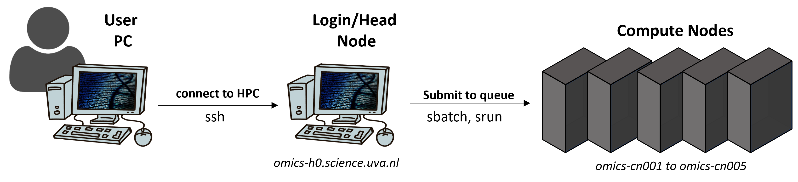

# HPC introduction

If you work at IBED you can get access to **Crunchomics**, the Genomics Compute Environment for SILS and IBED. Crunchomics is an **HPC** (high-performance computer): a group of powerful computers that many people share. Your contact person for Crunchomics is Wim de Leeuw ([w.c.deleeuw\@uva.nl](mailto:w.c.deleeuw@uva.nl){.email}).

Working on an HPC is a bit different from working on your own computer. The figure below gives a simplified overview:

- You log in from your own computer with `ssh`, as in the check when you set up your terminal (the left arrow in the figure).
- When you log in, you arrive on the **login node**, also called the **head node**. This computer is for preparing your work, for example moving and editing files and writing job scripts. It is not for running analyses. On Crunchomics this is `omics-h0`, the name you saw in your prompt when you logged in.
- The analyses run on the **compute nodes**. These computers have many more CPUs and much more memory than your laptop.
    -    A **CPU** is what does the calculations, so more CPUs means more work can get done at the same time.
    -    **Memory (RAM)** is the working space a program uses while it runs.
    -    Memory is not the same as **storage**, which is where your files are kept.
- In between is **SLURM**, a **workload manager** (also called a **scheduler**) that is used on many large HPCs. You send your analysis to SLURM as a **job**, and SLURM schedules the job to run on a compute node. In the figure, this is the arrow "Submit to queue". `sbatch` and `srun` are the two commands that send a job to SLURM. You use `srun` on the next page and `sbatch` is in a bonus section there. SLURM does three things:
    -    It gives users access to CPUs and memory on the compute nodes, for a limited time
    -    It starts and runs the jobs, and lets you check on them
    -    It manages the queue: the list of jobs that wait until enough CPUs and memory are free

## Storage

On Crunchomics, you have two folders. In these paths, `$USER` stands for your UvAnetID. You don't have to replace it yourself: when you use `$USER` in a command on Crunchomics, bash fills in your UvAnetID.

-    Your home directory, `/home/$USER`, with 25 GB of space
-    Your personal directory, `/zfs/omics/personal/$USER`, with 500 GB of space. Since this directory is larger, use it for all your analyses and software. On the next page, you make a shortcut to it, `~/personal`, and keep your project folder there

Good to know:

-    Your data is removed from Crunchomics when your UvAnetID expires
-    If you need more space, or a shared folder for a larger project with several team members, contact Wim de Leeuw
-    Crunchomics automatically saves copies of your files, called **snapshots**:
     -    It makes one every hour, kept for 24 hours, and one every day around midnight, kept for a week
     -    So if you delete a file by mistake, it can be restored for up to a week
     -    But files you delete also still count towards your storage limit for up to a week
     -    To restore a file, or to remove snapshots when you run out of space, contact Wim de Leeuw
-    Your data is stored on several disks, which protects it if one disk breaks. But it is not copied anywhere else. Crunchomics is not a backup or an archive. You are responsible for backing up your own data. The [website of the IBED computational support team](https://ibed.uva.nl/facilities/computational-facilities/ibed-computational-support-team/ibed-computational-support-team.html) explains the archiving options at the UvA

## Compute resources 

-    Crunchomics has 5 compute nodes, each with 64 CPUs and 512 GB of memory
-    If you need more resources, or GPUs, see [the website of the IBED computational support team](https://ibed.uva.nl/facilities/computational-facilities/ibed-computational-support-team)
-    You find more information in [the Crunchomics documentation](https://crunchomics-documentation.readthedocs.io/en/latest/)

::: callout-important
**Crunchomics etiquette**

You share Crunchomics with many other people, so only ask for the resources that you actually use. There are no hard limits, but please follow these rules:

-    Do NOT run jobs that need many CPUs or a lot of memory on the login node (`omics-h0`). Use the compute nodes (`omics-cn001` to `omics-cn005`) for this
-    Do NOT use more than 20% of the CPUs or memory of the cluster for more than a day. That is about one full compute node. If you have large jobs, contact Wim de Leeuw
-    Don’t leave resources that you reserved unused, and set reasonable time limits on your jobs
-    Use the queue (SLURM) for large jobs. Working directly on the login node is possible, but only for small tasks.
-    Close programs when you don’t use them anymore, for example an R session

You learn how to ask for resources and time on the next page. Please look back at the etiquette rules once you run your own analyses.
:::