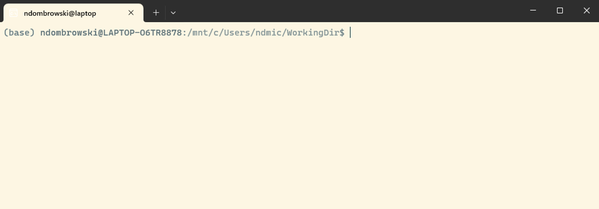

# Setting up a terminal

## Terminology

The **command-line interface (CLI)** is an alternative to a graphical user interface (GUI) that you probably know better. Both let you work with your computer but in different ways:

- In a **GUI**, you click buttons, open folders, and use menus
- In the **CLI**, you type text to issue **commands** (instructions to your computer) and you see the result as text

When people talk about the CLI, you will hear the words terminal, shell and prompt. They are related but not the same:

- The **terminal** is the window in which you type commands. It is sometimes also called **console**.
- The **shell** is the program that reads the commands you type in the terminal and tells the operating system what to do. There are several types of shells, for example, **bash** or **zsh**. They use slightly different rules, but the basic commands are the same. This course uses bash.
- A **prompt** is the text that the shell shows when it is ready for the next command. It often shows your user name, the name of your computer and the folder you are in. It usually ends with a `$` or `%` sign, for example `user@laptop:~$`


## Installation guides

### Windows

Unlike macOS or Linux, Windows doesn’t include a Unix-style terminal by default, so you will need to install one of the following:

1. MobaXterm (recommended)
    - Provides a terminal with Linux-like commands built-in
    - Installation guide: [MobaXterm setup instructions](https://hpc.ncsu.edu/Documents/mobaxterm.php). This is a guide from another university, you only need the "Installation instructions" and "Open a terminal"
    - Easiest option for beginners and lightweight to install
    - The Home Edition comes in two versions: the **installer edition** and the **portable edition**. The installer edition is preferred since with the portable version your home folder is deleted every time you close the application. 
    - After you install it, open MobaXterm and click on **Start local terminal**.
2. Windows Subsystem for Linux (WSL2)
    - Gives you a full Linux environment directly on Windows
    - Recommended if you’re comfortable installing software or already have some command-line experience
    - Uses Ubuntu by default, which includes Bash and all standard Linux tools
    - Installation guide: [ Microsoft WSL install instructions](https://learn.microsoft.com/en-us/windows/wsl/install)

### Mac

Every Mac comes with a terminal. You do not need to install anything. To open it, do one of these:

- In Finder, go to **Go** → **Utilities**, then open **Terminal**.
- Or press Cmd + Space to open Spotlight, type `Terminal` and press Return.

Newer Macs (macOS Catalina and later) use zsh as their shell, not bash. That is fine. Almost everything in this tutorial works the same way in zsh.


### Linux

Every Linux system comes with a terminal, and the shell is usually bash. You do not need to install anything. Open the terminal from your applications menu, or search for “Terminal” (depending on your system it can also be called Konsole or xterm).


## Sanity check

### Check 1: Test your terminal

When the terminal is open, you should see a window with a **prompt**, similar to the one below. Your prompt will show your own user name and computer name, and the colors may be different.



Type the command below in your terminal and press Enter. Type it exactly as it is shown. Capital letters matter.

```{bash}
# Print the name of the shell you are using
echo $SHELL
```

Lines that start with `#` are comments. They explain the code and you do not need to type them. `echo` prints text to the screen. `$SHELL` stands for the name of the shell you use, so together they print that name.

On my computer (WSL with Ubuntu) this prints:

```
/bin/bash
```

Your output may look a bit different. What matters is that you see a line that ends with `bash` or `zsh` (for example `/bin/zsh` on a newer Mac). If you see this, your terminal works and Check 1 is complete.


### Check 2: Test if you can log in to Crunchomics

Crunchomics is the HPC you can use at the UvA, a large computer you can connect and work with from your laptop. We use it later in the course for the analysis. We already organized that you get access to Crunchomics and here we check that the setup worked. 

**Your network**

You can only connect to Crunchomics from the UvA network:

- At the UvA, use the eduroam Wi-Fi. The open Amsterdam Science Park Wi-Fi does not work.
- From home or anywhere else, connect to the UvA VPN first. If you have not set up the VPN, or it does not work, contact the UvA ICT service desk.

To log in to Crunchomics, type the command below. Replace `uvanetid` with your own UvAnetID, and press Enter.

```{bash}
ssh -X uvanetid@omics-h0.science.uva.nl
```

What the parts mean:

-    `ssh` (secure shell) is the command that connects your terminal to another computer.
-    `-X` lets programs on Crunchomics open a window on your screen, for example to show a picture.
-    `uvanetid@` tells Crunchomics who you are.
-    `omics-h0.science.uva.nl` is the address of the computer you connect to.

Two things that surprise most people the first time:

-    The first time you connect, you may get a question that ends with `Are you sure you want to continue connecting (yes/no/[fingerprint])?`. Type yes and press Enter. Your computer then remembers Crunchomics and does not ask again.
-    Then you are asked for your password. Use your UvA password. While you type the password, nothing appears on the screen. No dots, no stars. That is normal. Type the password and press Enter.

If the login works, you see a welcome message similar to the one below, and the prompt changes. It now shows your UvAnetID and omics-h0, the name of the Crunchomics computer.


Every command you type now runs on Crunchomics, not on your laptop. For now, log out again:

```{bash}
# Log out of Crunchomics and return to your own laptop
exit
```

The prompt changes back to the one of your laptop. Check 2 is done.

**If the login does not work**

Check this first:

- Did you type your UvAnetID correctly, and is there an `@` between your UvAnetID and the address?
- Did you use the correct UvA password? Remember that nothing appears while you type it.
- Are you on eduroam (at the UvA) or connected to the VPN (outside the UvA)?

If this still does not work, tell your teachers.